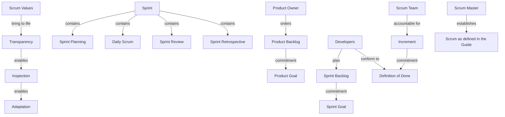

# Relationships

Canonical edges from the November 2020 Scrum Guide. Each line is `id | from | relation | to | topics | basis`. Basis is a paraphrase unless it uses quotation marks. Topic files repeat the lines they cite. Change the line here, then update those topic files.

The diagram is the serving picture for graph section (B). Present it as stored. Do not redraw it from the Guide.

## Theory

- R01 | Transparency | enables | Inspection | topics=01 | Transparency enables inspection. Inspection without transparency is misleading and wasteful.
- R02 | Inspection | enables | Adaptation | topics=01 | Inspection enables adaptation. Inspection without adaptation is pointless.
- R03 | Adaptation | is harder without | Self-managing | topics=01,07 | Adaptation becomes more difficult when people are not empowered or self-managing.
- R04 | Scrum Team | adapts on | Inspection | topics=01,07 | The Scrum Team adapts the moment it learns anything new through inspection.
- R05 | Five events | provide cadence for | Inspection | topics=01,04 | Scrum provides cadence in the form of its five events.
- R06 | Four events | inspect and adapt inside | Sprint | topics=04 | Four formal events for inspection and adaptation sit within the containing event, the Sprint.
- R07 | Scrum Values | bring to life | Transparency, Inspection, Adaptation | topics=02 | When the values are embodied, the pillars come to life, building trust.
- R08 | Forecast charts | do not replace | Empiricism | topics=01 | Burn-downs, burn-ups, and cumulative flows may be used. They do not replace empiricism. Only what has already happened may be used for forward-looking decisions.

## Team and accountabilities

- R09 | Scrum Team | consists of | one Scrum Master, one Product Owner, Developers | topics=03 | No other accountabilities are defined.
- R10 | Scrum Team | has no | sub-teams or hierarchies | topics=03 | It is a cohesive unit focused on one Product Goal.
- R11 | Scrum Team | is | cross-functional and self-managing | topics=03,07 | Cross-functional means the members have all the skills needed to create value each Sprint. Self-managing means they decide who does what, when, and how.
- R12 | Scrum Team | is typically | 10 or fewer people | topics=03 | Smaller teams communicate better and are more productive. Too large a team should reorganize.
- R13 | Multiple Scrum Teams on one product | share | Product Goal, Product Backlog, Product Owner | topics=03,11 | They remain focused on the same product.
- R14 | Scrum Team | is accountable for | a valuable, useful Increment every Sprint | topics=03,10 | This is the whole team, not one accountability alone.
- R15 | Product Owner | is accountable for maximizing | product value | topics=03,10 | How this is done may vary widely.
- R16 | Product Owner | is accountable for | Product Goal, creating and communicating items, ordering, Product Backlog transparency | topics=03,11 | These four are the Guide's list for effective Product Backlog management.
- R17 | Product Owner | may delegate | Product Backlog management work | topics=11 | The Product Owner remains accountable.
- R18 | Product Owner | is | one person, not a committee | topics=11,12 | The Product Owner may represent many stakeholders.
- R19 | Stakeholders | change the Product Backlog by | convincing the Product Owner | topics=11,12 | They do not order it themselves.
- R20 | Developers | are accountable for | the Sprint Backlog plan | topics=03,07 | Creating a plan for the Sprint, the Sprint Backlog.
- R21 | Developers | conform to | Definition of Done | topics=06,07 | Instilling quality by adhering to a Definition of Done. Developers are required to conform to it.
- R22 | Developers | adapt daily | the plan toward the Sprint Goal | topics=07 | This is a Developer accountability.
- R23 | Developers | hold accountable | each other as professionals | topics=07 | Not an external assignment of tasks.
- R24 | Developers | select | Sprint Backlog items | topics=04,11 | Through discussion with the Product Owner.
- R25 | Developers | size | Product Backlog items | topics=11 | The Product Owner may influence them by helping them understand and select trade-offs.
- R26 | Developers | alone decide how | Product Backlog items become Increments | topics=07 | No one else tells them how.
- R27 | Scrum Master | is accountable for establishing | Scrum as defined in the Guide | topics=09 | By helping everyone understand Scrum theory and practice, in the team and the organization.
- R28 | Scrum Master | is accountable for | the Scrum Team's effectiveness | topics=09 | By enabling the team to improve its practices within the Scrum framework.
- R29 | Scrum Master | serves | Scrum Team, Product Owner, organization | topics=08,09 | True leaders who serve. The Guide lists distinct services for each.
- R30 | Scrum Master | causes removal of | impediments | topics=08,09 | Causes removal. Does not define the Scrum Master as the only person who can remove one.
- R31 | Scrum Master | ensures | events happen and stay within the timebox | topics=08 | Positive, productive, and kept within the timebox.

## Sprint and events

- R32 | Sprint | contains | Sprint Planning, Daily Scrum, Sprint Review, Sprint Retrospective | topics=04 | The Sprint is a container for all other events. Refinement is not one of them.
- R33 | Sprint | is fixed at | one month or less | topics=04 | A new Sprint starts immediately after the previous Sprint concludes.
- R34 | During the Sprint | no changes endanger | Sprint Goal | topics=04,07 | Quality does not decrease. Scope may be clarified and renegotiated with the Product Owner as more is learned.
- R35 | Product Owner | alone may cancel | Sprint | topics=04 | Only if the Sprint Goal becomes obsolete.
- R36 | Sprint Planning | addresses | Why, What, How | topics=04 | Why: Sprint Goal, finalized before Planning ends. What: Developers select items. How: Developers plan the work.
- R37 | Product Owner | proposes | how the product could increase its value this Sprint | topics=04,10 | The whole Scrum Team then collaborates to define the Sprint Goal.
- R38 | Sprint Planning | is timeboxed to | at most 8 hours for a one-month Sprint | topics=04 | Usually shorter for a shorter Sprint. Others may be invited for advice.
- R39 | Daily Scrum | inspects | progress toward the Sprint Goal | topics=04 | And adapts the Sprint Backlog, adjusting the upcoming planned work.
- R40 | Daily Scrum | is | 15 minutes for the Developers | topics=04,08 | Same time and place every working day of the Sprint.
- R41 | Product Owner or Scrum Master | joins the Daily Scrum as a Developer only when | actively working on Sprint Backlog items | topics=04,08 | Otherwise the event is for the Developers.
- R42 | Developers | choose | Daily Scrum structure and techniques | topics=04,08 | As long as the event focuses on the Sprint Goal and produces an actionable plan for the next day.
- R43 | Developers | may adapt the plan | throughout the day | topics=04,07 | The Daily Scrum is not the only time they may adjust the plan.
- R44 | Sprint Review | inspects | the Sprint outcome and progress toward the Product Goal | topics=04,12 | Key stakeholders attend. Working session, not only a presentation. The Product Backlog may be adjusted.
- R45 | Increment | may be delivered | before the Sprint ends | topics=04,06,10 | The Sprint Review is not a gate to releasing value.
- R46 | Sprint Review | is timeboxed to | at most 4 hours for a one-month Sprint | topics=04 | Second to last event of the Sprint.
- R47 | Sprint Retrospective | inspects | individuals, interactions, processes, tools, and the Definition of Done | topics=04,06 | Purpose: plan ways to increase quality and effectiveness.
- R48 | Improvements | may be added to | the next Sprint Backlog | topics=04,06 | The most impactful improvements are addressed as soon as possible.
- R49 | Sprint Retrospective | concludes | the Sprint | topics=04 | At most 3 hours for a one-month Sprint.
- R50 | Skipping a prescribed event | loses | an opportunity to inspect and adapt | topics=04 | Failure to operate any events as prescribed results in lost opportunities to inspect and adapt.

## Artifacts and commitments

- R51 | Product Backlog | has commitment | Product Goal | topics=05,10 | The Product Goal is in the Product Backlog.
- R52 | Sprint Backlog | has commitment | Sprint Goal | topics=05 | Sprint Goal plus selected items plus plan are together the Sprint Backlog.
- R53 | Increment | has commitment | Definition of Done | topics=05,06 | Commitments reinforce empiricism and the Scrum values.
- R54 | Product Backlog | is | the single source of work for the Scrum Team | topics=05,11 | Emergent and ordered.
- R55 | Scrum Team | fulfills or abandons | one Product Goal before the next | topics=05,10 | The Product Goal is the long-term objective.
- R56 | Sprint Backlog | is a plan by and for | the Developers | topics=05,07 | Updated throughout the Sprint. Visible enough to inspect at the Daily Scrum.
- R57 | Sprint Goal | allows flexibility in | the exact work | topics=05,07 | It is a commitment by the Developers. If the work differs from expectations, they negotiate scope with the Product Owner without affecting the Sprint Goal.
- R58 | Increment | is additive, verified, and | usable | topics=05,10 | A concrete stepping stone toward the Product Goal. Multiple Increments may be created within a Sprint.
- R59 | Undone work | returns to | the Product Backlog | topics=06 | It cannot be released or presented at the Sprint Review. It is not part of an Increment.
- R60 | Meeting the Definition of Done | births | an Increment | topics=06 | The moment a Product Backlog item meets the Definition of Done, an Increment is born.
- R61 | Organizational Definition of Done | is a minimum for | all Scrum Teams | topics=06 | If there is no organizational standard, the Scrum Team must create a Definition of Done appropriate for the product.
- R62 | Multiple teams on one product | share | the same Definition of Done | topics=06 | They must mutually define and comply with it.
- R63 | Refinement | is an ongoing activity, not | an event | topics=04,11 | Items that can be Done within one Sprint are ready for selection. There is no Definition of Ready in the Guide.
- R64 | Product | has | a boundary, known stakeholders, and users or customers | topics=10,12 | A product is a vehicle to deliver value. It may be a service, a physical product, or something more abstract.
- R65 | Scrum Master | facilitates | stakeholder collaboration as requested or needed | topics=08,12 | Also removes barriers between stakeholders and Scrum Teams.
- R66 | Scrum | wraps | complementary practices | topics=09 | The framework is purposefully incomplete. Complementary tactics are described elsewhere. Using only parts of Scrum is not Scrum.
